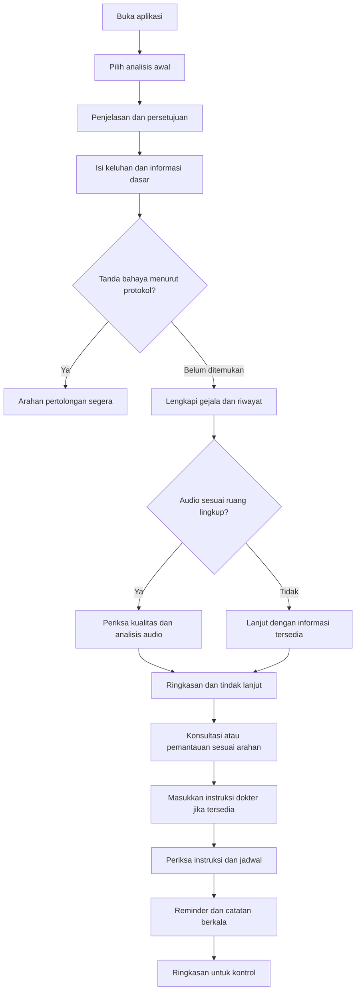
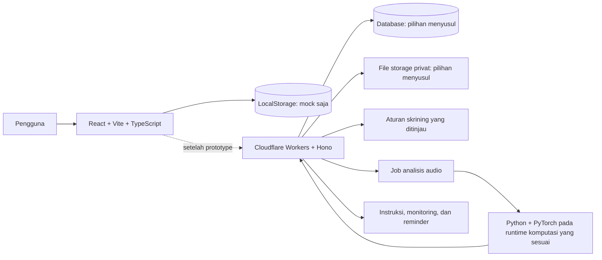

# NapasCare — Dokumen Proyek JOINTS UGM 2026

> Nama kerja: **NapasCare**. Nama dan merek belum ditetapkan.
>
> Versi: 1.0 | Tanggal: 11 Oktober 2026 | Bahasa: Indonesia
>
> Status: rancangan proyek dan panduan implementasi; aplikasi, model, kemitraan, validasi klinis, dan izin produk belum dinyatakan tersedia.
>
> Prinsip produk: **analisis awal → arahan tindak lanjut → pemantauan → pendampingan perawatan berdasarkan instruksi dokter**.

## Daftar isi

1. Ringkasan proyek
2. Latar belakang dan masalah
3. Tujuan dan indikator keberhasilan
4. Pengguna dan kebutuhan
5. Posisi produk dan nilai tambah
6. Ruang lingkup dan prioritas
7. Batas klaim medis
8. Alur pengguna
9. Kebutuhan fitur
10. Algoritma dan peran AI
11. Data, pelatihan, dan evaluasi
12. Arsitektur teknis
13. Model data
14. Rancangan antarmuka
15. Keamanan dan pengelolaan data
16. Monetisasi dan model bisnis
17. Regulasi dan pengembangan klinis
18. Rencana pengerjaan
19. Pengujian dan kriteria penerimaan
20. Risiko dan mitigasi
21. Strategi demonstrasi dan pitch
22. Pengembangan lanjutan
23. Keputusan dan pertanyaan terbuka
24. Referensi dan status bukti

---

## 1. Ringkasan proyek

NapasCare adalah konsep aplikasi kesehatan untuk membantu pengguna melakukan analisis awal atas keluhan pernapasan, memahami langkah tindak lanjut, dan mencatat perkembangan kondisi. Sesudah konsultasi, pengguna dapat memasukkan instruksi dokter untuk membuat pengingat dan menyusun ringkasan selama perawatan.

Fitur utama tetap **analisis awal**. Pengingat obat dan pencatatan harian memberikan kesinambungan setelah pengguna memperoleh arahan yang sesuai.

Masukan skrining berupa jawaban terstruktur mengenai gejala, durasi, riwayat, serta pengukuran yang tersedia. Analisis suara pernapasan merupakan modul eksperimen tambahan dengan batas penggunaan yang jelas.

Keluaran yang direncanakan:

- Ringkasan informasi yang diberikan pengguna.
- Tanda bahaya yang memerlukan tindak lanjut.
- Tingkat tindak lanjut berdasarkan protokol yang telah ditinjau tenaga medis.
- Hasil analisis audio jika masukan memenuhi persyaratan.
- Informasi yang belum tersedia dan keterbatasan penilaian.
- Langkah berikutnya dan fasilitas pencatatan.

**Fokus hackathon:** satu perjalanan pengguna untuk keluhan pernapasan, sejak skrining awal hingga pencatatan dan reminder dari instruksi dokter.

**Pengembangan berikutnya:** dukungan edukasi tanda bahaya dengue/DBD, estimasi risiko kardiovaskular, transkripsi penjelasan dokter, serta integrasi layanan kesehatan melalui kerja sama resmi.

## 2. Latar belakang dan masalah

Hipotesis masalah yang perlu dibuktikan melalui wawancara:

1. Orang dengan keluhan ringan sering kesulitan menentukan langkah berikutnya.
2. Pengguna dapat mencari penjelasan yang tidak sesuai dengan kondisinya.
3. Perubahan gejala sulit diingat saat konsultasi.
4. Instruksi obat dan jadwal kontrol dapat tersebar di dokumen atau percakapan.
5. Pasien memerlukan pencatatan yang membantu menjelaskan kondisi, tanpa proses administrasi yang berat.

Produk perlu menyelesaikan kebutuhan keputusan awal sekaligus menjaga hubungan dengan layanan medis.

### 2.1 Rumusan masalah

Bagaimana membantu pengguna memahami urgensi keluhan pernapasan dan menyiapkan informasi untuk konsultasi, kemudian menjalankan pencatatan serta pengingat sesuai rencana perawatan?

### 2.2 Hal yang perlu dibuktikan

- Pengguna memahami hasil skrining dan batasnya.
- Pengguna bersedia menjawab pertanyaan singkat.
- Ringkasan gejala membantu tenaga medis memahami riwayat.
- Analisis audio memberikan informasi tambahan pada perangkat yang dituju.
- Reminder dari dokumen lebih berguna daripada formulir manual saja.
- Pencatatan lanjutan memiliki alasan penggunaan yang jelas.

## 3. Tujuan dan indikator keberhasilan

### 3.1 Tujuan pengguna

- Mengetahui langkah tindak lanjut atas keluhan.
- Mencatat gejala dan perubahan kondisi.
- Membawa ringkasan yang mudah dipahami saat konsultasi.
- Mengingat jadwal dari instruksi yang telah diperiksa.
- Memahami istilah dan informasi kesehatan dari sumber terkurasi.

### 3.2 Tujuan hackathon

- Mendemonstrasikan alur yang benar-benar berfungsi.
- Menunjukkan evaluasi teknis yang dapat diperiksa.
- Menjelaskan sumber data dan batas performa model.
- Menampilkan kegagalan secara terkendali.
- Menghubungkan inovasi dengan kebutuhan pengguna.

### 3.3 Indikator dan target awal

Angka berikut merupakan target desain, belum hasil pengukuran.

| Indikator | Target awal | Metode |
|---|---|---|
| Penyelesaian alur skrining | Mayoritas peserta uji dapat selesai tanpa bantuan | Observasi pengguna |
| Pemahaman hasil | Peserta dapat menyebut langkah berikutnya dan keterbatasan hasil | Pertanyaan setelah penggunaan |
| Durasi skrining | Sekitar 3–5 menit pada skenario biasa | Pengukuran sesi |
| Kelengkapan ringkasan | Semua kolom wajib dan sumber informasi tercantum | Pemeriksaan keluaran |
| Kendali reminder | Tidak aktif sebelum instruksi diperiksa pengguna | Uji alur |
| Keamanan kasus darurat | Semua skenario darurat dalam suite yang disetujui memunculkan arahan yang benar | Uji skenario |
| Performa audio | Dilaporkan dengan metrik per kelas dan pemisahan pasien | Evaluasi model |
| Ketahanan audio | Audio tidak sesuai dapat ditolak | Uji masukan gagal |

Lolos uji skenario produk dan dataset belum membuktikan keamanan klinis pada populasi nyata.

## 4. Pengguna dan kebutuhan

### 4.1 Pengguna utama MVP

Hipotesis segmen: orang dewasa dengan keluhan pernapasan yang ingin memahami langkah awal, termasuk pengguna yang belum memiliki diagnosis.

Contoh kebutuhan:

- “Aku mengalami batuk dan perubahan napas; informasi apa yang perlu dicatat?”
- “Apakah aku perlu segera mencari pertolongan?”
- “Apa yang perlu aku sampaikan saat konsultasi?”
- “Setelah diperiksa dokter, bagaimana aku mengingat instruksinya?”

### 4.2 Pengguna pendampingan

Pasien yang memiliki instruksi perawatan dari tenaga medis. Aplikasi mengelola instruksi yang sudah tersedia dan catatan perkembangan.

### 4.3 Pengguna sekunder

- Anggota keluarga yang diberi izin mengakses informasi tertentu.
- Dokter atau klinik penerima ringkasan atas pilihan pasien.
- Admin operasional yang mengelola konten dan dukungan tanpa akses otomatis ke data klinis.

Dashboard klinik dan akun keluarga penuh masuk pengembangan berikutnya.

### 4.4 Batas populasi awal

MVP ditujukan untuk skenario dewasa. Anak, kehamilan, dan kondisi khusus memerlukan protokol tersendiri sebelum fitur skrining diperluas. Pengguna di luar ruang lingkup tetap memperoleh informasi cara mencari bantuan; aplikasi tidak memberi skor dari model yang tidak sesuai.

Pembatasan ini merupakan keputusan desain awal, bukan pernyataan bahwa model telah tervalidasi untuk seluruh orang dewasa.

## 5. Posisi produk dan nilai tambah

### 5.1 Pernyataan posisi

NapasCare membantu pengguna menilai langkah awal atas keluhan pernapasan, menyiapkan informasi untuk konsultasi, dan menjalankan pencatatan serta pengingat berdasarkan instruksi dokter.

### 5.2 Nilai tambah

| Nilai | Implementasi |
|---|---|
| Analisis awal terarah | Pertanyaan terstruktur dan penjelasan tindak lanjut |
| Informasi lebih lengkap | Gejala, durasi, sumber pengukuran, serta audio yang sesuai |
| Kesinambungan | Data skrining dapat dilanjutkan menjadi catatan pemantauan |
| Instruksi mudah dikelola | Dokumen menjadi draf jadwal yang diperiksa pengguna |
| Riwayat dapat dibawa | Ringkasan bertanggal untuk konsultasi |
| Ketidakpastian terlihat | Status tidak dapat dinilai dan alasan kegagalan |
| Pengguna memegang kendali | Aktivasi reminder dan berbagi data memerlukan tindakan pengguna |

### 5.3 Pembeda yang harus dibuktikan

Kekuatan produk bergantung pada kualitas alur dan bukti manfaat. Tim perlu memeriksa produk pembanding sebelum membuat klaim keunikan. Analisis audio, chatbot, dan reminder masing-masing belum cukup menjadi klaim bahwa produk adalah yang pertama atau paling akurat.

## 6. Ruang lingkup dan prioritas

| Prioritas | Fitur | Hasil yang ditargetkan |
|---|---|---|
| P0 | React, Vite, TypeScript, navigasi | Fondasi prototype web |
| P0 | Form skrining dan validasi | Alur interaktif memakai data simulasi |
| P0 | Hasil skrining simulasi | Menjelaskan tindak lanjut sebagai demo, bukan hasil klinis |
| P0 | Monitoring dan grafik | Riwayat contoh dari LocalStorage |
| P0 | Instruksi dan reminder demo | Pengguna dapat mencoba alur pemeriksaan dan pengingat |
| P0 | Penyimpanan LocalStorage | Data sintetis di browser saja |
| P1 | API backend | Cloudflare Workers + Hono setelah prototype |
| P1 | Analisis audio | Eksperimen dataset, training, dan inferensi terpisah |
| P1 | OCR dokumen | Draf instruksi dengan penanda ambigu |
| P2 | Grafik dari data layanan | Setelah backend dan model data tersedia |
| P2 | Transkripsi dokter | Setelah ada persetujuan dan alur koreksi |
| P2 | Akun keluarga dan klinik | Akses berbasis izin |
| P2 | Dukungan dengue/DBD | Edukasi dan alur tindak lanjut tersendiri |
| P2 | Risiko kardiovaskular | Input dan model tersendiri |
| P2 | Integrasi layanan mitra | Berdasarkan kontrak dan akses resmi |

P0 adalah lingkup empat hari pertama: frontend dan data simulasi. Backend dan model AI belum menjadi dependensi prototype. LocalStorage hanya menyimpan contoh di browser dan tidak untuk data pasien nyata. Analisis audio boleh ditampilkan sebagai mock yang jelas diberi label atau sebagai eksperimen offline pada sampel riset; jangan menyebutnya inferensi mikrofon HP yang sudah tervalidasi.

MVP tidak mengasumsikan akses database Halodoc, alat medis milik pengguna, model klinis yang sudah tersedia, atau notifikasi yang pasti diterima.

## 7. Batas klaim medis

### 7.1 Jenis hasil yang dibedakan

| Jenis | Arti |
|---|---|
| Skrining gejala | Pemeriksaan awal dari informasi pengguna |
| Triase | Penentuan tingkat tindak lanjut sesuai protokol |
| Klasifikasi audio | Pengenalan kategori pola suara |
| Estimasi risiko | Perkiraan kejadian pada jangka waktu tertentu |
| Diagnosis klinis | Penetapan kondisi melalui proses medis yang sesuai |
| Pendampingan | Pencatatan dan pengingat dari instruksi tersedia |

Keluaran model audio harus tetap disebut hasil pola suara. Probabilitas kelas audio tidak boleh ditampilkan sebagai persentase kemungkinan suatu penyakit.

### 7.2 Pernapasan

Suara napas, frekuensi napas, dan keluhan sesak adalah masukan berbeda. Aplikasi mencatat sumber dan cara memperoleh masing-masing data.

Label audio “tanpa wheeze/crackle terdeteksi” tidak membuktikan pengguna sehat. Gejala dan tanda bahaya tetap diproses.

### 7.3 Dengue/DBD

Napas cepat merupakan salah satu tanda bahaya dengue berat. Hal itu belum menjadi dasar untuk mendiagnosis DBD lewat rekaman napas. Pengembangan dengue perlu menggunakan informasi klinis yang relevan dan jalur pemeriksaan medis. [WHO—Dengue](https://www.who.int/news-room/fact-sheets/detail/dengue-and-severe-dengue)

Istilah dengue, dengue berat, dan DBD perlu digunakan sesuai konteks klinis; aplikasi tidak menyamakan seluruh keluhan demam dengan DBD.

### 7.4 Kardiovaskular

Pengembangan risiko kardiovaskular menggunakan faktor risiko yang sesuai. Model WHO memprediksi kejadian kardiovaskular dalam 10 tahun dengan faktor seperti usia, merokok, tekanan darah, diabetes, dan kolesterol; tersedia pendekatan tanpa laboratorium. Pemilihan model mengikuti populasi, rentang usia, dan wilayahnya. [Penelitian model WHO](https://pmc.ncbi.nlm.nih.gov/articles/PMC7025029/)

Estimasi risiko jangka panjang tidak menilai kejadian serangan jantung akut.

### 7.5 Prinsip tindak lanjut

- Tanda bahaya mendapat prioritas sebelum analisis audio.
- Rekaman tidak meyakinkan menghasilkan status tidak dapat dinilai.
- Informasi kurang tidak diisi dengan asumsi klinis.
- Penilaian rendah tidak boleh ditulis sebagai “bebas penyakit”.
- Pengobatan dan perubahan dosis mengikuti instruksi tenaga medis.
- Jadwal pemantauan mengikuti rencana perawatan atau protokol yang ditinjau.
- Hasil skrining tidak otomatis menjadi izin perawatan mandiri.

## 8. Alur pengguna

### 8.1 Diagram utama

Diagram adalah rancangan alur. Kriteria tanda bahaya dan pemantauan belum menjadi protokol klinis yang disetujui.

### 8.2 Pengguna pertama kali

1. Memilih analisis awal tanpa diwajibkan mengunggah resep.
2. Membaca tujuan fitur dan menyetujui pemrosesan yang diperlukan.
3. Mengisi informasi dasar, keluhan, serta durasi.
4. Menjawab pemeriksaan tanda bahaya.
5. Melengkapi pertanyaan yang relevan.
6. Mencoba audio jika tersedia dan sesuai.
7. Membaca hasil dengan tindakan utama yang jelas.
8. Memilih menyimpan atau mengunduh ringkasan.

Pengguna tidak harus memiliki diagnosis untuk melakukan alur analisis awal.

### 8.3 Hasil dan tindak lanjut

Status yang direncanakan:

- **Perlu pertolongan segera:** tindakan ditampilkan langsung.
- **Perlu konsultasi:** jelaskan informasi yang mendasari dan langkah konsultasi.
- **Pemantauan sesuai protokol/rencana:** tampilkan hal yang dicatat dan kondisi untuk mencari bantuan.
- **Belum dapat dinilai:** jelaskan kekurangan informasi atau kegagalan masukan.

Kata “aman” tidak digunakan sebagai hasil otomatis.

### 8.4 Setelah konsultasi

1. Pengguna memasukkan instruksi manual atau mengunggah dokumen.
2. Sistem menampilkan draf dan bagian sumbernya.
3. Pengguna memeriksa nama, aturan, durasi, serta jadwal.
4. Bagian ambigu diarahkan untuk dikonfirmasi kepada dokter/apoteker.
5. Pengguna mengaktifkan reminder.
6. Pengguna mencatat status minum obat dan gejala.
7. Sistem membuat ringkasan dari catatan yang benar-benar tersedia.

Pemeriksaan oleh pengguna bukan pengesahan medis atas instruksi yang ambigu.

### 8.5 Check-in

Jadwal tidak ditentukan seragam untuk seluruh pengguna. Aplikasi menyimpan siapa yang menetapkan jadwal, alasan, periode, dan kapan perlu ditinjau.

Jika keluhan memburuk, pengguna dapat menjalankan pemeriksaan tindak lanjut tanpa menunggu check-in berikutnya.

## 9. Kebutuhan fitur

### 9.1 Persyaratan fungsional

| ID | Persyaratan | Kriteria penerimaan |
|---|---|---|
| FR-01 | Pengguna memilih analisis awal | Bisa dimulai sebelum ada instruksi dokter |
| FR-02 | Persetujuan dicatat | Tujuan, versi teks, dan waktu tersedia |
| FR-03 | Form gejala terstruktur | Kolom wajib diverifikasi; jawaban dapat diperbaiki |
| FR-04 | Tanda bahaya mendapat prioritas | Arahan muncul tanpa menunggu audio/LLM |
| FR-05 | Informasi tidak lengkap ditandai | Sistem tidak membuat nilai pengganti |
| FR-06 | Audio memiliki pemeriksaan kualitas | Dapat ditolak dengan alasan |
| FR-07 | Hasil dapat ditelusuri | Ada versi aturan/model dan masukan yang relevan |
| FR-08 | Catatan tersimpan | Riwayat dapat ditampilkan kembali |
| FR-09 | Instruksi manual tersedia | Tidak tergantung keberhasilan OCR |
| FR-10 | OCR menghasilkan draf | Draf belum mengaktifkan reminder |
| FR-11 | Jadwal dapat diperiksa | Sumber dan bagian ambigu terlihat |
| FR-12 | Reminder dapat dikendalikan | Aktif, edit, jeda, dan hentikan |
| FR-13 | Status obat dilaporkan pengguna | Bedakan diminum, dilewati, dan belum dicatat |
| FR-14 | Ringkasan konsultasi | Preview sebelum unduh/berbagi |
| FR-15 | Penghapusan dapat diminta | Ada proses dan penjelasan retensi |
| FR-16 | Data demonstrasi diberi label | Tidak tercampur dengan data nyata |
| FR-17 | Materi edukasi memiliki sumber | Referensi dan tanggal tinjau tersedia |

### 9.2 Persyaratan nonfungsional

- Desain mendukung layar ponsel dan desktop.
- Bahasa utama Indonesia dengan istilah sederhana.
- Status proses, gagal, dan selesai terlihat.
- Proses lambat memiliki timeout dan jalur lanjut.
- Ringkasan tetap dapat diakses saat layanan audio gagal.
- Form tidak kehilangan data tanpa pemberitahuan.
- Waktu tersimpan dengan zona waktu yang jelas.
- Notifikasi tidak menjadi satu-satunya tempat menampilkan jadwal.
- Tidak ada data klinis mentah pada log aplikasi biasa.
- Fitur berbagi menggunakan tindakan eksplisit pengguna.
- Angka confidence hanya digunakan sesuai makna modelnya.

## 10. Algoritma dan peran AI

### 10.1 Pembagian tugas

| Modul | Pendekatan | Tugas |
|---|---|---|
| Gejala dan tindak lanjut | Aturan terstruktur yang ditinjau klinisi | Konsistensi dan keterlacakan |
| Kualitas audio | Pemeriksaan sinyal dan kesesuaian masukan | Menolak input tidak layak |
| Kategori suara | Model klasifikasi | Mengenali pola pada data sesuai |
| Dokumen | OCR dan ekstraksi terstruktur | Membuat draf instruksi |
| Penjelasan lisan | Transkripsi dan ekstraksi | Pengembangan setelah MVP |
| Edukasi | Konten terkurasi | Bahasa mudah dipahami |
| Ringkasan | Template; LLM opsional | Merangkum catatan tanpa fakta baru |
| Risiko kardiovaskular | Model risiko yang sesuai | Pengembangan tersendiri |

LLM bukan penentu bebas diagnosis, dosis, maupun keputusan darurat.

### 10.2 Algoritma skrining gejala

Urutan logika yang direncanakan:

1. Periksa kelayakan populasi dan kelengkapan masukan.
2. Periksa tanda bahaya berdasarkan protokol yang disetujui.
3. Jika ada tanda bahaya, tampilkan arahan segera.
4. Jika tidak, proses pertanyaan lanjutan.
5. Catat masukan audio sebagai informasi tambahan jika sesuai.
6. Tentukan tindak lanjut dengan aturan yang bisa diperiksa.
7. Tampilkan alasan, informasi kurang, dan sumber.

Ambang, daftar pertanyaan, serta interval tindak lanjut harus ditetapkan bersama tenaga medis. Tidak ada skor berbobot buatan yang diperlakukan sebagai skor klinis tervalidasi.

Untuk demo sebelum peninjauan, gunakan skenario simulasi yang diberi label. Jangan mengoperasikan aturan simulasi sebagai layanan skrining publik.

### 10.3 Algoritma audio

Rancangan eksperimen:

1. Validasi format, durasi, dan jenis sumber.
2. Pemeriksaan clipping, amplitudo, serta kebisingan.
3. Resampling dan normalisasi yang konsisten dengan proses pelatihan.
4. Segmentasi siklus napas dari anotasi dataset.
5. Ekstraksi MFCC untuk model pembanding SVM.
6. Ekstraksi log-mel spectrogram untuk CNN kecil sebagai kandidat.
7. Evaluasi kedua pendekatan dengan split pasien.
8. Kalibrasi dan pemilihan aturan penolakan pada data validasi.
9. Kunci konfigurasi sebelum pengujian akhir.

Segmentasi otomatis pada rekaman mentah harus dievaluasi terpisah. Performa pada siklus yang sudah dianotasi tidak sama dengan performa alur unggah rekaman penuh.

Kategori awal:

- Wheeze.
- Crackle.
- Kombinasi keduanya.
- Tanpa kedua pola tersebut terdeteksi.
- Tidak dapat dinilai.

Kategori audio tidak dipetakan otomatis menjadi diagnosis penyakit.

### 10.4 Persyaratan perangkat

Suara dada melalui alat auskultasi tidak diasumsikan setara dengan suara dari mikrofon HP dekat mulut.

Pilihan demo:

- Analisis sampel riset dengan sumber yang ditampilkan.
- Rekaman perangkat yang sesuai setelah ada data dan pengujian pendukung.
- Rekaman HP sebagai eksperimen eksploratif yang belum digunakan untuk keputusan klinis.

Hasil laboratorium tidak dijadikan klaim performa seluruh perangkat.

### 10.5 Ekstraksi instruksi dokter

Kolom draf:

- Nama obat sesuai tulisan sumber.
- Kekuatan sediaan jika tercantum.
- Dosis dan satuan jika tercantum.
- Frekuensi.
- Waktu atau hubungan dengan makan jika tercantum.
- Durasi atau tanggal akhir jika tercantum.
- Aturan bila diperlukan, jika tercantum.
- Sumber dokumen/halaman dan potongan teks.
- Status terbaca, tidak tersedia, atau ambigu.

Instruksi ambigu tidak diubah menjadi jadwal otomatis. Sistem tidak menebak singkatan, menaikkan dosis, menyimpulkan tanggal akhir, atau menyarankan menggandakan dosis yang terlewat.

### 10.6 Reminder

Reminder dibentuk dari instruksi yang telah diperiksa dan jadwal yang dipilih pengguna sesuai instruksi.

Gunakan ID kejadian agar sinkronisasi tidak menggandakan reminder. Simpan zona waktu, waktu lokal, status, serta versi jadwal.

Status “diminum” merupakan laporan pengguna; tidak disebut bukti pasti kepatuhan atau efektivitas terapi.

## 11. Data, pelatihan, dan evaluasi

Bagian ini adalah rencana eksperimen model setelah atau di luar pekerjaan frontend empat hari. Training tidak dijalankan di aplikasi web dan bukan syarat agar prototype dapat didemokan.

### 11.1 Dataset awal

ICBHI 2017 dapat dipelajari sebagai dataset riset suara pernapasan: 920 rekaman dari 126 subjek, dikumpulkan dengan beberapa mikrofon/stetoskop klinis, bukan sebagai bukti model mikrofon HP. Anotasi siklus menghasilkan empat kelas pola suara; satu analisis dataset melaporkan 3.642 siklus tanpa crackle/wheeze, 1.864 crackle, 886 wheeze, dan 506 keduanya. Kelas dominan tidak boleh membuat evaluasi hanya mengandalkan akurasi. [ICBHI 2017](https://bhichallenge.med.auth.gr/node/50), [analisis populasi dan label](https://journals.plos.org/digitalhealth/article?id=10.1371%2Fjournal.pdig.0001179)

Untuk target dewasa, file demografi perlu dipetakan menurut ID subjek sebelum preprocessing: satu analisis melaporkan 49 anak, 22 peserta usia 18–64, 54 usia ≥65, dan satu usia tidak diketahui. Filter ≥18 tahun menyisakan kelompok kecil dan didominasi lansia; laporkan distribusi ini dan jangan menganggapnya mewakili semua pengguna dewasa. File demografi dipakai untuk umur; file diagnosis dan file anotasi suara memiliki fungsi berbeda.

Tidak diasumsikan bahwa dataset ini menyediakan model diagnosis DBD atau seluruh penyakit kardiovaskular.

### 11.2 Data tiap fitur

| Fitur | Data | Sumber awal |
|---|---|---|
| Demo skrining | Gejala dan skenario | Sintetis, kemudian ditinjau klinisi |
| Eksperimen audio | Audio, anotasi, ID pasien, perangkat | Dataset riset sesuai izin |
| OCR | Contoh instruksi | Dokumen sintetis |
| Reminder | Jadwal contoh | Data sintetis |
| Pengujian antarmuka | Tugas dan umpan balik | Partisipan sukarela |
| Pilot klinis | Data pasien | Setelah persetujuan dan prosedur penelitian/layanan yang sesuai |

### 11.3 Pencegahan kebocoran data

- Terapkan filter populasi dan split menurut ID pasien sebelum pemotongan siklus atau augmentasi.
- Pasien yang sama tidak masuk train, validation, dan test.
- Gunakan split resmi ICBHI bila sesuai; validation diambil berkelompok pasien dari data train, sedangkan test resmi disimpan untuk evaluasi akhir.
- Jangan mengubah test resmi hanya agar distribusi kelas tampak seimbang; laporkan jumlah subjek dan kelas sesudah filter umur.
- Split dilakukan sebelum augmentasi.
- Statistik preprocessing dipelajari pada train saja.
- Test tidak dipakai menentukan hyperparameter.
- Augmentasi tidak dipakai menambah “pasien baru” pada laporan.
- Data duplikat dan versi file diperiksa.
- Model, seed, konfigurasi, dan split disimpan.

### 11.4 Metrik

- Macro-F1 dan metrik per kelas.
- Sensitivitas serta spesifisitas dengan definisi positif yang jelas.
- Confusion matrix.
- Ukuran sampel dan distribusi kelas.
- Proporsi audio yang ditolak.
- Kinerja pada data yang diterima setelah penolakan.
- Latensi dan kegagalan layanan.
- Analisis menurut perangkat jika jumlah data memungkinkan.

Bila memungkinkan, interval ketidakpastian dihitung dengan memperhatikan pengelompokan pasien. Akurasi keseluruhan saja dapat menutupi kegagalan kelas minoritas.

### 11.5 Tahapan bukti

1. Bukti teknis pada dataset.
2. Bukti penggunaan melalui uji antarmuka.
3. Peninjauan tenaga medis atas materi dan aturan.
4. Pengujian perangkat serta populasi yang dituju.
5. Validasi klinis sesuai desain penelitian.
6. Evaluasi manfaat dalam layanan nyata.

Tahap awal tidak dianggap telah menyelesaikan tahap berikutnya.

## 12. Arsitektur teknis

### 12.1 Stack yang dipilih untuk prototype dan roadmap

Prototype empat hari membangun pengalaman web yang interaktif. Backend dan model AI sungguhan dijadwalkan setelah alur pengguna sudah terlihat.

| Kebutuhan | Prototype empat hari | Tahap lanjutan |
|---|---|---|
| Frontend | React + Vite + TypeScript | Dipertahankan untuk web app |
| Styling | Tailwind CSS | Dipertahankan |
| Komponen UI | shadcn/ui | Dipakai bila mempercepat implementasi |
| Navigasi | React Router | Route untuk skrining, hasil, monitoring, reminder |
| State awal | React Hooks | Tambah state library hanya jika kompleksitas menuntut |
| Form dan validasi | React Hook Form + Zod | Validasi server ditambahkan kemudian |
| Grafik | Recharts | Grafik dari riwayat backend pada tahap lanjutan |
| Ikon | Lucide React | Ikon antarmuka |
| Data prototype | Mock data + LocalStorage | Bukan penyimpanan data pasien |
| Backend | Belum diperlukan | Cloudflare Workers + Hono |
| Training dan model audio | Belum diperlukan di aplikasi | Python + PyTorch, training offline |
| Penyimpanan file/DB | Belum diperlukan untuk demo | Pilih layanan setelah kebutuhan privasi dan integrasi ditetapkan |

Gunakan versi dependency yang dikunci saat implementasi. Pilihan ini menghindari kerja server pada empat hari pertama, tetapi tetap memberi struktur komponen dan rute yang dapat dipertahankan.

**Batas LocalStorage:** gunakan hanya mock/sintetis. Data di browser dapat dibaca oleh kode pada origin yang sama dan tidak memberi kontrol akses, retensi, sinkronisasi, atau perlindungan yang layak untuk catatan kesehatan nyata. Jangan meminta pengguna demo memasukkan resep atau informasi kesehatan pribadi.

### 12.2 Alur komponen

Pada prototype, hanya jalur FE → LocalStorage/mock yang dibuat. Pada tahap lanjutan, Hono menjadi API untuk autentikasi, validasi, aturan, dan status job; model PyTorch dilatih offline, lalu artefaknya dipasang pada layanan inferensi yang mendukung dependensinya. Hono tidak menjalankan training.

Cloudflare Workers memiliki batas CPU dan memori; dokumentasi saat ini mencantumkan memori 128 MB per isolate dan batas CPU per request sesuai plan/konfigurasi. Python Workers mendukung paket Python murni atau paket yang tersedia melalui Pyodide/PyEmscripten, sehingga jangan mengasumsikan stack PyTorch yang dibutuhkan model dapat langsung dijalankan di dalam Worker. Evaluasi dukungan paket dan batas runtime saat implementasi; pilihan aman adalah Worker memanggil layanan inferensi Python terpisah. [Workers limits](https://developers.cloudflare.com/workers/platform/limits/), [Python Workers packages](https://developers.cloudflare.com/workers/languages/python/packages/).

### 12.3 Rancangan API

| Endpoint | Fungsi |
|---|---|
| POST /screenings | Membuat sesi skrining |
| PATCH /screenings/:id/answers | Menyimpan jawaban |
| POST /screenings/:id/complete | Menghasilkan hasil dengan versi aturan |
| POST /screenings/:id/audio | Menambahkan audio yang diizinkan |
| GET /screenings/:id/result | Membaca hasil dan status proses |
| POST /care-instructions | Membuat instruksi manual/draf dokumen |
| PATCH /care-instructions/:id | Memperbaiki draf |
| POST /care-instructions/:id/confirm | Mencatat pemeriksaan pengguna |
| POST /medication-schedules | Membuat jadwal dari instruksi yang memenuhi syarat |
| PATCH /medication-schedules/:id | Mengubah, menjeda, atau menghentikan jadwal |
| POST /medication-events/:id/report | Mencatat laporan status |
| POST /check-ins | Menyimpan catatan |
| GET /summaries/:id | Preview ringkasan milik pengguna |
| POST /summaries/:id/share | Membuat akses berbagi yang terbatas |
| POST /data-deletion-requests | Mengajukan penghapusan |

Tabel ini adalah rancangan tahap backend, bukan endpoint yang perlu dibangun dalam empat hari. Pada prototype, frontend memakai fungsi/data mock dengan kontrak tipe yang dapat dipetakan ke API nanti. Setelah backend ada, semua operasi memeriksa hak akses terhadap objek, bukan hanya status login. Endpoint final dapat berubah setelah kebutuhan autentikasi dan penyimpanan diputuskan.

### 12.4 Penanganan kegagalan

- Dalam prototype: setiap hasil skrining/audio harus diberi label simulasi; jangan menyiratkan bahwa backend atau model sudah berjalan.
- Audio gagal: pada tahap backend, catat status dan lanjutkan informasi gejala yang tersedia.
- OCR gagal: sediakan input manual.
- Notifikasi gagal: jadwal tetap terlihat di aplikasi.
- Ringkasan AI gagal: gunakan template dari catatan.
- Upload terputus: tampilkan status dan opsi mencoba kembali.
- Database gagal: jangan menampilkan status tersimpan.
- Layanan melambat: jangan menunda arahan tanda bahaya.
- Perubahan instruksi: jadwal lama dihentikan/diperbarui secara terkontrol.

## 13. Model data

Entitas berikut adalah rancangan logis untuk tahap backend. Prototype empat hari memakai objek mock di state React/LocalStorage; entitas ini belum menjadi database, dan tidak boleh diisi dengan informasi pasien nyata.

### 13.1 Entitas

| Entitas | Kolom utama |
|---|---|
| users | id, auth_id, locale, timezone, created_at |
| profiles | user_id, informasi relevan, status kelayakan |
| consents | user_id, purpose, notice_version, granted_at, withdrawn_at |
| screenings | id, user_id, status, mode, created_at, completed_at |
| symptom_answers | screening_id, question_id, value, source |
| measurements | user_id, type, value, unit, measured_at, device/source |
| audio_records | screening_id, private_key, device, position, quality_status |
| audio_results | audio_id, model_version, class, confidence, rejection_reason |
| triage_results | screening_id, protocol_version, outcome, reasons, missing_fields |
| care_documents | user_id, private_key, document_type, extraction_status |
| care_instructions | document_id, source_text, structured_fields, ambiguity_flags, review_status |
| medication_schedules | instruction_id, timezone, start_at, end_at, status, version |
| medication_events | schedule_id, planned_at, user_report, reported_at |
| check_ins | user_id, symptom_fields, notes, created_at |
| summaries | user_id, period, structured_content, generated_at |
| share_grants | user_id, summary_id, recipient_scope, expires_at, revoked_at |
| audit_events | actor_id, action, resource_id, timestamp, minimal_metadata |
| deletion_requests | user_id, status, requested_at, completed_at |

### 13.2 Aturan integritas

- Data memiliki pemilik dan kontrol akses.
- Instruksi menyimpan sumber dan status pemeriksaan.
- Hasil menyimpan versi model/aturan.
- Nilai pengukuran menyimpan satuan dan sumber.
- Status obat menyimpan waktu kejadian dan waktu laporan.
- Jadwal ambigu tidak aktif.
- Jadwal yang dihentikan tidak membuat kejadian baru.
- Data demo memiliki penanda eksplisit.
- Penghapusan mencakup turunan data yang relevan.
- Akses berbagi dapat dicabut.
- Nilai null berarti tidak tersedia, bukan hasil normal.

## 14. Rancangan antarmuka

| Layar | Isi utama | Tindakan |
|---|---|---|
| Beranda | Analisis awal, riwayat, dan jadwal | Mulai skrining |
| Penjelasan | Tujuan fitur dan data | Setuju sesuai tujuan |
| Keluhan | Gejala utama dan durasi | Lanjut |
| Tanda bahaya | Pertanyaan prioritas | Lihat arahan segera jika relevan |
| Detail | Riwayat dan informasi tambahan | Periksa jawaban |
| Audio | Panduan, sumber, dan kualitas | Unggah/rekam sesuai kemampuan |
| Hasil | Tindak lanjut, alasan, keterbatasan | Simpan ringkasan |
| Pemantauan | Catatan gejala dan jadwal | Tambah catatan |
| Instruksi | Input manual atau dokumen | Periksa draf |
| Reminder | Jadwal dan status laporan | Aktifkan/edit |
| Ringkasan | Riwayat bertanggal | Preview dan unduh |
| Pengaturan data | Persetujuan dan akses berbagi | Cabut/hapus sesuai proses |

Prinsip desain:

- Tindakan berikutnya tampil sebelum penjelasan panjang.
- Warna selalu disertai teks.
- Tampilkan “belum dapat dinilai” secara jelas.
- Form memiliki indikator kemajuan.
- Hindari angka kesehatan buatan seperti “kesehatan Anda 90%”.
- Tampilkan sumber pengukuran dan tanggal.
- Hindari jargon pada layar pengguna.
- Ringkasan membedakan laporan pengguna, hasil model, dan instruksi dokter.

Contoh hasil simulasi:

> Ringkasan Anda sudah disiapkan. Informasi yang tersedia menunjukkan perlunya tindak lanjut sesuai skenario demonstrasi ini. Analisis audio belum dapat digunakan untuk memastikan penyebab keluhan. Lihat informasi yang perlu dibawa saat konsultasi.

Teks klinis final membutuhkan peninjauan tenaga medis.

## 15. Keamanan dan pengelolaan data

Persyaratan desain yang diusulkan:

- Pengumpulan data sesuai tujuan fitur.
- Penyimpanan audio/dokumen bersifat privat.
- Akses berbagi memiliki masa berlaku dan dapat dicabut.
- Enkripsi saat pengiriman dan penyimpanan sesuai layanan yang dipilih.
- Rahasia layanan hanya berada di server.
- Akses berbasis peran dan kepemilikan objek.
- Log operasional tidak memuat resep, gejala lengkap, atau rekaman.
- Jenis, ukuran, dan isi file divalidasi.
- Retensi dijelaskan sebelum pengguna mengunggah data.
- Cadangan dan proses penghapusan didokumentasikan.
- Penyedia OCR/LLM ditinjau dari lokasi pemrosesan, retensi, dan ketentuan data.
- Data layanan tidak dipakai melatih model secara otomatis.
- Persetujuan pelatihan model dibuat terpisah jika memang dibutuhkan.
- Audio dokter direkam hanya setelah persetujuan pihak yang terkait.

Masa retensi belum ditetapkan. Keputusan ini harus mempertimbangkan tujuan, hubungan dengan layanan klinis, kewajiban yang berlaku, serta penyimpanan cadangan. Jangan menjanjikan seluruh data langsung hilang jika mekanisme teknis dan kewajibannya belum dipastikan.

Jika terjadi insiden, tim perlu memiliki prosedur pembatasan akses, penilaian dampak, pemulihan, dan pemberitahuan sesuai aturan.

## 16. Monetisasi dan model bisnis

### 16.1 Hipotesis pendapatan

| Model | Pembayar | Manfaat yang dijual | Hal yang divalidasi |
|---|---|---|---|
| Langganan klinik | Klinik | Pengelolaan catatan dan ringkasan tindak lanjut | Penghematan waktu dan beban operasional |
| Paket keluarga | Pengguna/keluarga | Pengelolaan beberapa anggota dengan izin | Kesediaan membayar |
| Program tindak lanjut | Mitra layanan | Layanan dalam program perawatan | Biaya, tanggung jawab, dan hasil |
| Integrasi resmi | Mitra | Penghubung alur dan data berizin | Akses teknis serta kontrak |

Hipotesis utama untuk diuji: klinik kecil atau layanan rawat jalan membayar fungsi pencatatan dan koordinasi tindak lanjut. Manfaat tersebut belum terbukti.

Peringatan keselamatan tidak ditempatkan di balik pembayaran. Pendapatan tidak bergantung pada menjual data kesehatan.

### 16.2 Simulasi keuangan

Seluruh angka berikut adalah **asumsi perencanaan**, bukan harga pasar atau penawaran vendor.

| Komponen | Asumsi per bulan |
|---|---:|
| Pendapatan 1 klinik, paket 100 pasien aktif | Rp750.000 |
| Alokasi infrastruktur | Rp200.000 |
| Alokasi pemrosesan | Rp100.000 |
| Alokasi dukungan | Rp150.000 |
| Kontribusi sebelum biaya lain | Rp300.000 |

Perhitungan: Rp750.000 − Rp200.000 − Rp100.000 − Rp150.000 = Rp300.000.

Simulasi belum memasukkan gaji, tenaga medis, penelitian, perizinan, akuisisi pelanggan, pajak, dan biaya perangkat. Angka ini bukan laba bersih.

Untuk analisis impas:

**Jumlah pelanggan impas = biaya tetap / (pendapatan per pelanggan − biaya variabel per pelanggan).**

Definisikan biaya tetap dan variabel secara konsisten agar tidak dihitung dua kali. Harga final mengikuti hasil pilot, volume penggunaan, dan biaya nyata.

### 16.3 Business Model Canvas

| Elemen | Rancangan |
|---|---|
| Customer segments | Pengguna dengan keluhan pernapasan; pasien tindak lanjut; klinik mitra |
| Value propositions | Skrining terarah, riwayat mudah dibawa, reminder dari instruksi |
| Channels | Pilot klinik, komunitas pasien, edukasi digital |
| Customer relationships | Onboarding sederhana, dukungan, kontrol data |
| Revenue streams | Langganan klinik dan paket pengguna yang diuji |
| Key activities | Pengembangan, evaluasi model, peninjauan konten, dukungan |
| Key resources | Tim, data berizin, perangkat uji, mitra klinis |
| Key partners | Tenaga medis, klinik, penyedia infrastruktur, mitra integrasi |
| Cost structure | Infrastruktur, pemrosesan, penelitian, klinis, kepatuhan, dukungan |

### 16.4 Pilot bisnis

1. Wawancarai calon pengguna dan tenaga medis.
2. Tentukan satu masalah operasional yang terukur.
3. Uji prototipe dengan skenario sintetis.
4. Ukur waktu, pemahaman, dan beban tambahan klinik.
5. Uji kesediaan membayar setelah manfaat terlihat.
6. Rancang pilot nyata hanya setelah persyaratan klinis dan data dipenuhi.

Kemitraan Halodoc belum ada. Integrasi dipertimbangkan melalui akses dan persetujuan resmi; roadmap tidak mengasumsikan hak atas database pihak lain.

## 17. Regulasi dan pengembangan klinis

### 17.1 Pelindungan data pribadi

UU No. 27 Tahun 2022 menggolongkan data kesehatan sebagai data pribadi spesifik. Tim perlu menetapkan dasar pemrosesan, peran pengendali/prosesor, pemberitahuan kepada pengguna, serta penanganan hak dan insiden sesuai keadaan layanan. [UU PDP](https://peraturan.bpk.go.id/Details/229798/uu-no-27-tahun-2022)

### 17.2 Alat kesehatan berbasis perangkat lunak

Kepmenkes HK.01.07/MENKES/951/2026 mengatur pedoman izin edar alat kesehatan berbasis perangkat lunak, termasuk SaMD dan aplikasi AI. Fungsi skrining, pemantauan, dan dukungan diagnosis dapat termasuk ruang lingkupnya. Penilaian kewajiban mengikuti fungsi dan tujuan penggunaan nyata; label “edukasi” tidak otomatis mengubah klasifikasi. [Pedoman Kemenkes](https://jdih.kemkes.go.id/storage/documents/pdfs/2026kepmenkes951.pdf)

### 17.3 Penerapan pada proyek

Langkah yang direncanakan:

- Susun tujuan penggunaan dan klaim yang akan disampaikan.
- Minta penilaian klasifikasi serta jalur yang berlaku sebelum penggunaan klinis.
- Tinjau hubungan dengan kewajiban layanan kesehatan, rekam medis, dan sistem elektronik bila relevan.
- Rancang dokumentasi kualitas, risiko, keamanan, dan bukti performa.
- Tentukan kebutuhan persetujuan etik dan izin penelitian bersama institusi terkait.
- Pisahkan demo sintetis dari layanan untuk pasien nyata.

Daftar tersebut merupakan rencana kepatuhan, bukan pernyataan bahwa persyaratan sudah dipenuhi. Status regulasi diperiksa kembali sebelum pilot atau peluncuran.

## 18. Rencana pengerjaan

### 18.1 Pembagian tim empat orang

| Peran | Tanggung jawab |
|---|---|
| Produk, riset, dan koordinasi klinis | Kebutuhan pengguna, materi, aturan, pitch |
| Frontend dan UX | Form, hasil, riwayat, instruksi, ringkasan |
| Data/API | Tipe data mock, kontrak API, kebutuhan akses untuk roadmap |
| AI dan evaluasi | Manifest dataset, kualitas audio, split pasien, eksperimen baseline offline |

Semua anggota membantu demonstrasi dan pemeriksaan integrasi. Peninjauan klinis memerlukan pihak yang kompeten; anggota tim tidak dianggap otomatis memiliki kewenangan klinis.

### 18.2 Jadwal kerja usulan

Panduan lokal yang telah dibaca mencantumkan technical meeting pada 12 Oktober dan pengumpulan 15–16 Oktober 2026. Rincian tenggat dan perubahan harus dikonfirmasi pada panitia/technical meeting. Jadwal internal ini menggunakan WIB.

| Tanggal | Fokus | Hasil |
|---|---|---|
| Hari 1 | Setup React/Vite/TypeScript, Tailwind, routing, desain dasar | Kerangka halaman dan navigasi |
| Hari 2 | Form skrining, validasi, hasil skenario simulasi | Alur analisis awal dapat diklik |
| Hari 3 | Monitoring, grafik Recharts, reminder dan data LocalStorage | Alur setelah skrining dapat didemokan |
| Hari 4 | Rapikan responsif, empty/error states, data demo, dan pitch | Prototype siap direkam |

Rencana model audio berlangsung sebagai eksperimen terpisah bila kapasitas tim memungkinkan: cek lisensi dan manifest, filter demografi, split pasien, latih baseline, evaluasi. Hasil eksperimen bisa dipresentasikan sebagai bukti riset, tetapi integrasi model bukan syarat agar frontend prototype selesai.

Sisa waktu menuju tenggat lomba dipakai untuk integrasi, video, deck, perbaikan hasil uji, dan pengumpulan. Tanggal final tetap mengikuti technical meeting dan pengumuman panitia.

### 18.3 Urutan implementasi

1. Kunci perjalanan pengguna dan batas klaim.
2. Definisikan data serta hak akses.
3. Bangun alur skrining dan hasil simulasi.
4. Bangun catatan dan instruksi manual.
5. Bangun reminder serta ringkasan.
6. Jalankan eksperimen audio sejak awal secara terpisah.
7. Pastikan semua data demo sintetis dan hasil simulasi diberi label.
8. Siapkan video, deck, source code, dan dokumentasi.
9. Setelah hackathon, bangun API Hono dan penyimpanan berizin.
10. Latih/evaluasi model audio offline; integrasikan layanan inferensi hanya setelah batas perangkat dan runtime dipahami.
11. Tambahkan OCR setelah P0 dan kontrol data backend tersedia.

### 18.4 Keputusan lanjut/tunda

- Tidak ada peninjauan klinis: tetap gunakan simulasi berlabel.
- Tidak ada bukti perangkat HP: audio memakai sampel riset.
- OCR belum stabil: input manual menjadi jalur utama.
- Integrasi notifikasi belum tersedia: jadwal hanya simulasi di aplikasi.
- Tidak ada backend: jangan mengklaim data tersinkron atau tersimpan di cloud.
- Performa model lemah: tampilkan hasil sebenarnya dan rencana perbaikan.
- P0 belum selesai: tunda fitur keluarga, klinik, dan penyakit tambahan.

## 19. Pengujian dan kriteria penerimaan

Rencana berikut belum dijalankan.

| Skenario | Hasil yang diharapkan |
|---|---|
| Pengguna belum memiliki diagnosis | Tetap dapat mulai analisis awal |
| Tanda bahaya dalam skenario yang ditinjau | Arahan muncul sebelum audio |
| Audio tampak normal tetapi gejala darurat | Hasil audio tidak menurunkan arahan |
| File audio bising/tidak sesuai | Ditolak atau tidak dapat dinilai |
| Audio dari perangkat berbeda | Tidak diklaim setara tanpa pengujian |
| OCR salah nama/dosis | Draf dapat diperbaiki; tidak aktif otomatis |
| Dokumen tanpa durasi | Sistem tidak menebak tanggal akhir |
| Instruksi bila diperlukan | Tidak diubah menjadi jadwal rutin tanpa dasar |
| Jadwal diubah | Kejadian lama ditangani; tidak ganda |
| Pengguna belum melapor | Tidak dianggap pasti melewatkan obat |
| Notifikasi gagal | Jadwal tetap terlihat |
| Pengguna lain membuka objek | Akses ditolak |
| Akses berbagi dicabut | Tautan tidak lagi membuka informasi |
| Ringkasan dibuat | Hanya berisi data yang tersedia dan sumbernya |
| Layanan AI gagal | Jalur manual/template tetap tersedia |
| Anak atau populasi di luar scope | Tidak menerima penilaian dari model dewasa |

### 19.1 Definition of Done untuk hackathon

- Alur awal sampai pendampingan dapat didemonstrasikan.
- Data demo diberi label.
- Source code disertai cara menjalankan.
- Rahasia dan data pribadi tidak masuk repository.
- Metrik model dan konfigurasi evaluasi tersedia.
- Keterbatasan perangkat terlihat.
- Fitur gagal tidak menghasilkan status palsu.
- Instruksi reminder dapat diperiksa dan dihentikan.
- Video, deck, dan prototype siap.
- Dokumen tidak mengklaim validasi klinis atau kemitraan yang belum ada.

### 19.2 Uji pengguna awal

Usulan: 5–8 calon pengguna dan 1–2 tenaga medis untuk peninjauan awal, jika tersedia.

Tugas:

1. Mulai analisis awal tanpa resep.
2. Jelaskan tindakan setelah membaca hasil.
3. Temukan keterbatasan audio.
4. Perbaiki kesalahan pada draf instruksi sintetis.
5. Hentikan reminder.
6. Buat ringkasan konsultasi.

Jumlah kecil tersebut bertujuan menemukan masalah penggunaan, bukan membuktikan akurasi klinis atau dampak kesehatan.

## 20. Risiko dan mitigasi

| Risiko | Dampak | Mitigasi |
|---|---|---|
| Klaim penyakit melebihi bukti | Pengguna salah memahami hasil | Batasi klaim dan tinjau teks |
| False reassurance | Menunda pemeriksaan | Tanda bahaya prioritas; hindari label sehat |
| False positive | Kekhawatiran dan konsultasi tidak perlu | Evaluasi aturan/model serta penjelasan |
| Dataset tidak mewakili perangkat | Kinerja turun | Uji perangkat, batasi mode |
| Kebocoran train/test | Metrik tampak terlalu tinggi | Split pasien dan audit data |
| OCR keliru | Jadwal salah | Draf, sumber, koreksi, blokir ambigu |
| LLM menambah fakta | Ringkasan menyesatkan | Template dan validasi terhadap sumber |
| Alert terlalu banyak | Pengguna mengabaikan | Sesuaikan jadwal dan evaluasi beban |
| Notifikasi tidak terkirim | Jadwal terlewat | Jadwal dalam aplikasi; status transparan |
| Data tersebar | Risiko privasi | Minimalisasi dan kontrol akses |
| Scope melebar | MVP tidak selesai | P0/P1/P2 dan titik keputusan |
| Mitra belum tersedia | Integrasi gagal | Aplikasi mandiri dan ekspor berizin |
| Beban kerja klinik naik | Monetisasi sulit | Ukur manfaat operasional pada pilot |
| Belum ada peninjauan klinis | Aturan tidak layak dipakai nyata | Demo simulasi dan rencana mitra |

## 21. Strategi demonstrasi dan pitch

### 21.1 Kesesuaian JOINTS

Panduan lokal yang dibaca pada diskusi proyek:

| Aspek | Bobot | Bukti yang ditunjukkan |
|---|---:|---|
| Inovasi solusi | 25% | Hubungan analisis awal dengan pendampingan |
| Implementasi teknis | 30% | Alur berfungsi, evaluasi audio, penanganan gagal |
| Fungsionalitas dan desain | 20% | Pengguna memahami tindakan dan dapat mengendalikan jadwal |
| Dampak dan kelayakan | 15% | Riset kebutuhan, batas klaim, rencana pilot |
| Presentasi dan demonstrasi | 10% | Cerita pengguna yang jelas dan bukti nyata |

Sumber: GDBOOK.pdf di folder proyek, terutama halaman 9, 11, dan 13. Informasi ini berasal dari panduan lokal yang dibaca sebelumnya; perubahan panitia perlu diperiksa.

### 21.2 Materi pengumpulan

Panduan tersebut mencantumkan:

- Video publik di YouTube, maksimal dua menit: wajib.
- Source code pada repository GitHub: wajib.
- Pitch deck PDF: wajib.
- Prototype/mockup: wajib.
- Proposal PDF maksimal 10 halaman: opsional.

Konfirmasi kembali ketentuan pada technical meeting.

### 21.3 Cerita demo dua menit

| Durasi | Isi |
|---|---|
| 0–20 detik | Keluhan pengguna dan kesulitan menentukan langkah awal |
| 20–50 detik | Form skrining, prioritas tanda bahaya, dan hasil |
| 50–75 detik | Analisis audio nyata dengan sumber yang dijelaskan |
| 75–100 detik | Instruksi sintetis diperiksa dan reminder diaktifkan |
| 100–115 detik | Catatan perkembangan dan ringkasan |
| 115–120 detik | Manfaat serta batas bukti utama |

Siapkan contoh audio tidak layak dan instruksi ambigu sebagai bukti penanganan gagal.

### 21.4 Susunan pitch deck

1. Masalah pengguna.
2. Segmen awal dan temuan riset.
3. Konsep analisis awal lalu pendampingan.
4. Perjalanan pengguna.
5. Demo produk.
6. Algoritma, sumber data, dan hasil evaluasi.
7. Keamanan, batas klaim, dan rencana klinis.
8. Model bisnis dan hipotesis pilot.
9. Pengembangan berikutnya.
10. Tim dan kebutuhan dukungan.

Jika belum ada hasil evaluasi, tulis “belum diukur” dan tampilkan rencana; jangan mengisi angka contoh sebagai hasil.

### 21.5 Pertanyaan juri yang perlu dijawab

- Apa yang benar-benar dianalisis dari audio?
- Mengapa alat rekam yang digunakan sesuai dengan dataset?
- Bagaimana pembagian pasien train/test?
- Apa yang terjadi ketika audio normal tetapi pengguna sesak?
- Siapa yang meninjau aturan tindak lanjut?
- Bagaimana mencegah OCR mengaktifkan jadwal yang salah?
- Apa manfaat bagi pengguna yang belum punya diagnosis?
- Mengapa pengguna akan kembali?
- Siapa yang membayar dan manfaat apa yang terukur?
- Apa status regulasi dan kemitraan?

## 22. Pengembangan lanjutan

### Tahap A — Prototipe hackathon

React + Vite + TypeScript; Tailwind, React Router, React Hook Form/Zod; alur skrining, monitoring, dan reminder dengan mock data/LocalStorage. Tidak ada backend, data pasien, atau inferensi AI langsung di aplikasi. Model/audio hanya simulasi berlabel atau eksperimen dataset offline.

### Tahap B — Validasi kebutuhan dan perangkat

Wawancara, uji antarmuka, peninjauan klinis, cek lisensi/demografi, training baseline Python + PyTorch, dan evaluasi perangkat target. Tentukan apakah audio benar-benar menambah manfaat.

### Tahap C — Backend dan integrasi AI

Cloudflare Workers + Hono menjadi API. Pilih database dan penyimpanan privat setelah kebutuhan akses, retensi, dan biaya ditetapkan. Jalankan model PyTorch sebagai layanan inferensi pada runtime yang mendukung paket dan beban model; Worker memvalidasi permintaan dan mengelola status pekerjaan, bukan menjalankan training.

### Tahap D — Pilot klinis terstruktur

Persetujuan dan prosedur yang sesuai, populasi jelas, protokol tetap, metrik klinis yang ditentukan bersama mitra, dan pengawasan.

### Tahap E — Layanan pendampingan

Akun keluarga, dashboard klinik, kontrol akses berbagi, dan pengukuran manfaat operasional.

### Tahap F — Modul tambahan

- Dengue/DBD: edukasi dan tindak lanjut berbasis informasi relevan.
- Kardiovaskular: estimasi risiko menggunakan model serta data sesuai.
- Transkripsi instruksi dokter dengan persetujuan.
- Integrasi layanan melalui kerja sama resmi.

Masing-masing modul memiliki tujuan, data, protokol, dan evaluasi tersendiri.

## 23. Keputusan dan pertanyaan terbuka

### 23.1 Keputusan rancangan awal

- Analisis awal tetap menjadi fitur utama.
- Pendampingan merupakan kelanjutan setelah hasil dan/atau konsultasi.
- MVP berfokus pada satu alur pernapasan.
- Audio merupakan bukti pola suara dengan batas perangkat.
- Tidak ada diagnosis DBD dari audio.
- Risiko kardiovaskular menjadi modul terpisah pada pengembangan berikutnya.
- Instruksi dokter dibaca sebagai draf yang diperiksa.
- Data demonstrasi sintetis/riset berizin diberi label.
- Mitra dan akses database belum diasumsikan tersedia.
- Harga dan indikator bisnis adalah hipotesis.

### 23.2 Pertanyaan yang perlu diselesaikan

| Pertanyaan | Penanggung jawab | Kapan |
|---|---|---|
| Apa keluhan pernapasan paling relevan untuk pengguna awal? | Produk dan klinisi | Sebelum alur final |
| Apakah tim memiliki mitra medis untuk peninjauan? | Koordinator | Sebelum penggunaan nyata |
| Apa perangkat audio yang benar-benar dituju? | AI dan produk | Sebelum klaim performa |
| Apakah dataset boleh didistribusikan dalam demo? | AI dan koordinator | Sebelum upload |
| Apa versi aturan dan populasi targetnya? | Klinisi dan produk | Sebelum pilot |
| Apa ambang penolakan audio? | AI | Dari validasi, sebelum test |
| Apa kanal reminder yang dapat berfungsi? | Backend | Saat integrasi |
| Bagaimana data diproses penyedia OCR/LLM? | Backend dan koordinator | Sebelum data nyata |
| Berapa retensi yang sesuai? | Koordinator dan mitra | Sebelum layanan |
| Apa tenggat tepat dan perubahan aturan JOINTS? | Koordinator | Technical meeting |
| Berapa biaya riil dan kesediaan membayar? | Produk/bisnis | Pilot |
| Apa klasifikasi dan jalur izin produk? | Mitra regulasi | Sebelum penggunaan klinis |

## 24. Referensi dan status bukti

### 24.1 Referensi utama

1. **Guidebook JOINTS 2026**, file GDBOOK.pdf di folder proyek. Dibaca secara visual pada diskusi sebelumnya; ketentuan dapat berubah.
2. **ICBHI 2017 Respiratory Sound Database** — [situs penyelenggara](https://bhichallenge.med.auth.gr/node/50). Informasi dataset diperoleh pada diskusi sebelumnya; akses langsung 11 Oktober 2026 mengalami timeout, sehingga lisensi dan isi unduhan perlu diperiksa kembali.
3. **WHO, Dengue** — [fakta dan informasi klinis](https://www.who.int/news-room/fact-sheets/detail/dengue-and-severe-dengue). Diakses 11 Oktober 2026.
4. **WHO CVD Risk Chart Working Group (2019)** — [penelitian model risiko kardiovaskular](https://pmc.ncbi.nlm.nih.gov/articles/PMC7025029/). Dibaca pada diskusi sebelumnya; akses ulang 11 Oktober 2026 menampilkan pemeriksaan browser.
5. **UU No. 27 Tahun 2022 tentang Pelindungan Data Pribadi** — [JDIH BPK](https://peraturan.bpk.go.id/Details/229798/uu-no-27-tahun-2022). Diakses 11 Oktober 2026.
6. **Kepmenkes HK.01.07/MENKES/951/2026** — [naskah pedoman izin edar alat kesehatan berbasis perangkat lunak](https://jdih.kemkes.go.id/storage/documents/pdfs/2026kepmenkes951.pdf). Diakses 11 Oktober 2026.

### 24.2 Status bukti proyek saat dokumen dibuat

| Hal | Status |
|---|---|
| Konsep analisis awal lalu pendampingan | Arah dari diskusi pengguna |
| Nama NapasCare | Usulan nama kerja |
| Segmen pengguna | Hipotesis |
| Fitur, stack, dan API | Rancangan |
| Aplikasi berfungsi | Belum dinyatakan tersedia |
| Dataset sudah diunduh/diperiksa | Belum dikonfirmasi |
| Model sudah dilatih | Belum dikonfirmasi |
| Metrik performa | Belum diukur |
| Aturan klinis ditinjau | Belum dikonfirmasi |
| Uji perangkat HP | Belum dilakukan |
| Wawancara pengguna | Belum dikonfirmasi |
| Validasi klinis | Belum dilakukan |
| Izin dan kepatuhan produk | Belum dinilai tuntas |
| Mitra klinik/Halodoc | Belum ada yang dikonfirmasi |
| Harga, biaya, dan manfaat bisnis | Asumsi untuk diuji |

Dokumen ini menjadi acuan menyelaraskan tim dan membuat implementasi yang dapat ditinjau. Keputusan final mengikuti kemampuan tim, hasil riset, peninjauan klinis, dan ketentuan lomba terbaru.
